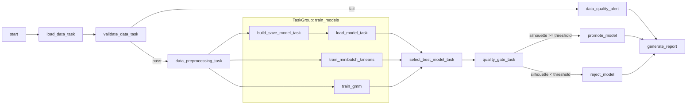
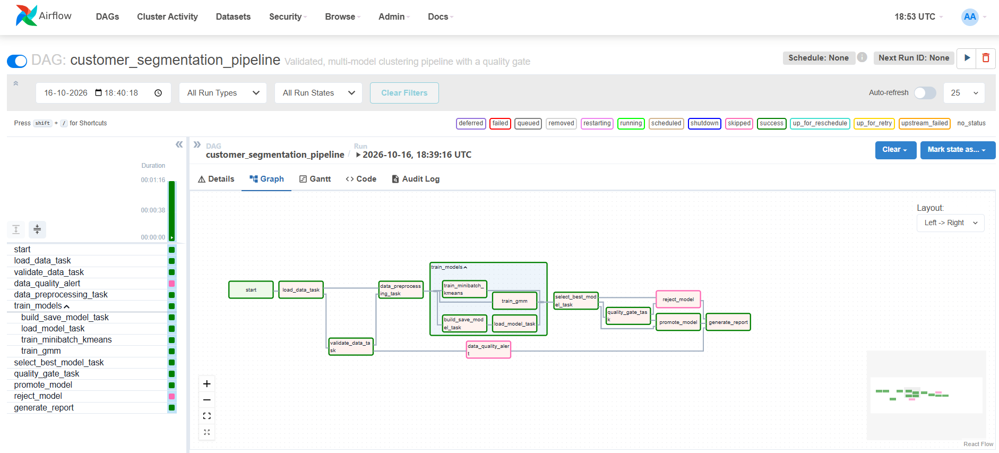
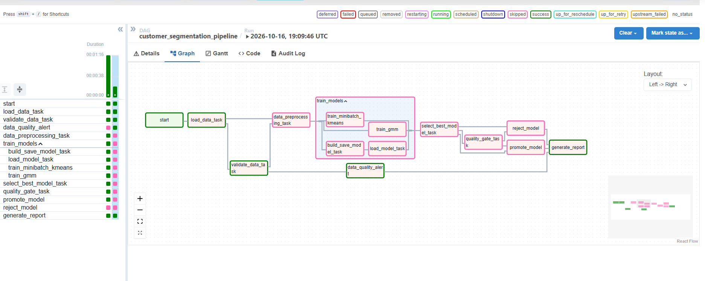
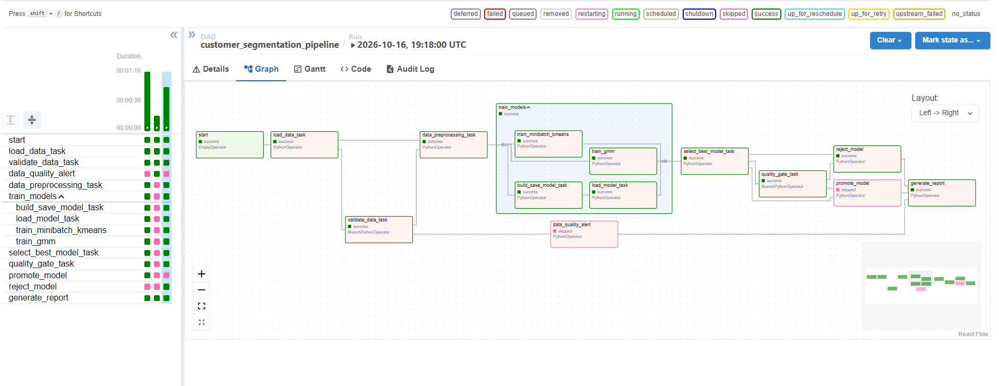
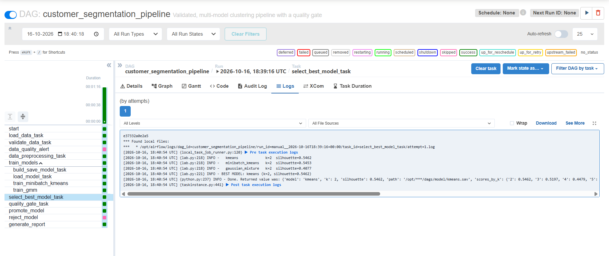
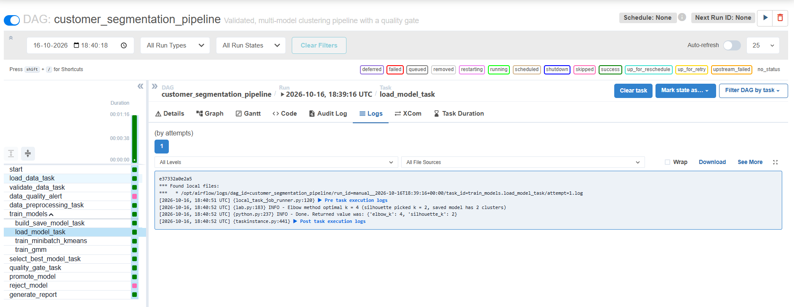
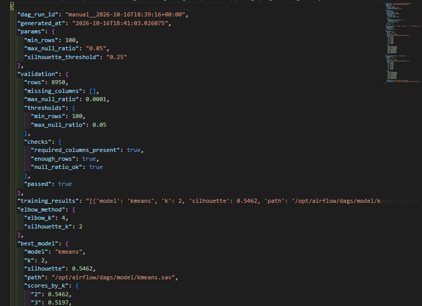
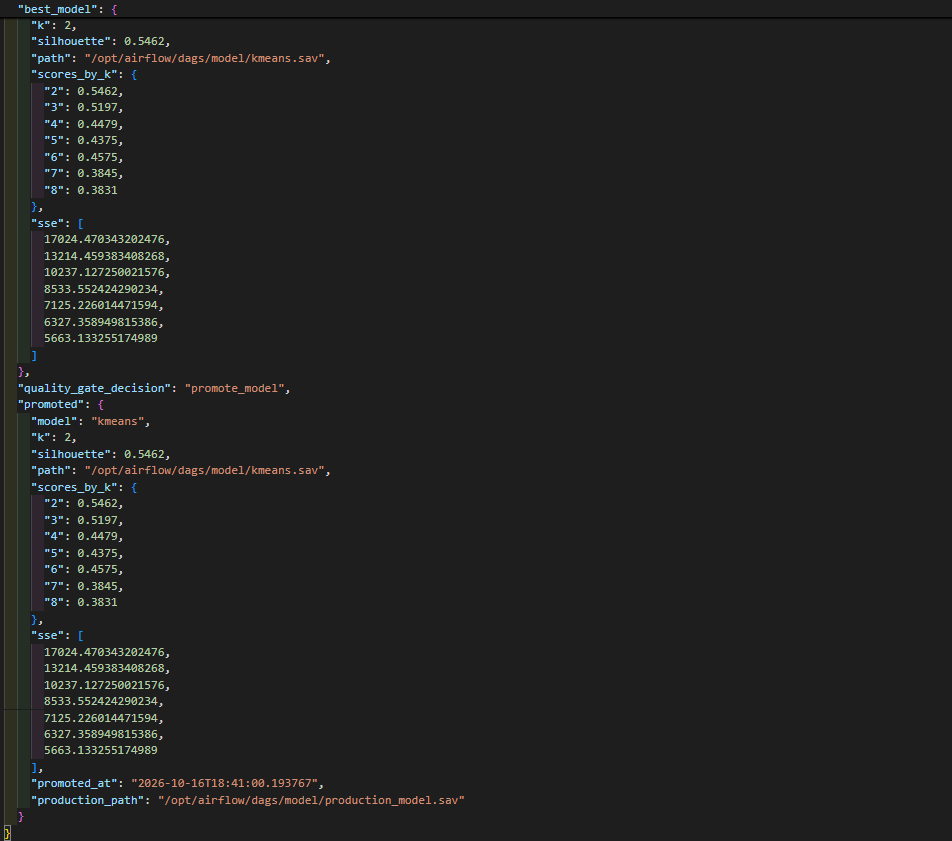

# Airflow Lab 1 (Modified): Validated Multi-Model Customer Segmentation Pipeline

This lab builds on the course's Airflow Lab 1 (KMeans clustering on credit card customer data). The original DAG ran four tasks in a straight line:

```
load_data_task >> data_preprocessing_task >> build_save_model_task >> load_model_task
```

All four original tasks are **kept**. I extended the **orchestration logic itself** around them, so the DAG now has these features:

- It **validates the data** and **branches**: training runs only if the data passes the checks. Otherwise an alert task runs.
- It **trains three clustering algorithms in parallel** inside a TaskGroup.
- It **automatically picks the best model** using the silhouette score.
- A **quality gate** branches again and promotes the model to "production" only if it is good enough.
- It **always writes a final JSON report**, whichever path the run took.
- It uses **retries, a failure callback, and runtime parameters** that you can change when you trigger the DAG.

---

## 1. Pipeline overview



Tasks from the original lab: `load_data_task`, `data_preprocessing_task`, `build_save_model_task`, `load_model_task`. Every other task is new.

---

## 2. Changes I made

| # | Change | File | What it does / why it matters |
|---|--------|------|-------------------------------|
| 1 | **Data validation + branching** (`BranchPythonOperator`) | `dags/airflow.py`, `validate_data()` in `dags/src/lab.py` | Checks for the required columns, a minimum row count, and the null ratio. If the data fails, the DAG skips training and runs `data_quality_alert`, so a model is never trained on bad data. |
| 2 | **Parallel training in a TaskGroup** | `dags/airflow.py`, `train_minibatch_kmeans()`, `train_gmm()` | The original KMeans task (`build_save_model_task`, followed by the elbow method in `load_model_task`) now runs **at the same time** as two new algorithms: MiniBatchKMeans and a Gaussian Mixture model. Each one searches k = 2–8. |
| 3 | **Automatic model selection** | `select_best_model()` | Pulls all three results from XCom and picks the model with the highest silhouette score. The original elbow result is still computed and is included in the final report for comparison. |
| 4 | **Quality gate (second branch)** | `quality_gate()`, `promote_model()`, `reject_model()` | The best model is copied to `model/production_model.sav`, with a metadata JSON, **only** if its silhouette score is at least the threshold. Otherwise it is rejected and the production model stays unchanged. |
| 5 | **Trigger rule for the join** | `generate_report` task | Uses `none_failed_min_one_success`, so the final report runs no matter which branch was taken. |
| 6 | **Runtime parameters** | `params` in the DAG | `min_rows`, `max_null_ratio`, and `silhouette_threshold` can be changed in the trigger form in the UI (▶ Trigger DAG), with no code edits. |
| 7 | **Reliability** | `default_args` | 2 retries with a 1-minute delay, plus an `on_failure_callback` that logs which task failed. |
| 8 | **JSON-safe XCom** | `dags/src/lab.py` | Data moves between tasks as JSON instead of pickled objects, so XCom pickling no longer has to be enabled. |
| 9 | **Preprocessing** | `data_preprocessing()` | Uses `StandardScaler` instead of `MinMaxScaler`, and saves the scaler to `model/scaler.sav`. |

---

## 3. Prerequisites (install these first)

| Tool | Version I used | Where to get it |
|------|----------------|-----------------|
| Git | 2.42+ | https://git-scm.com |
| Docker Desktop | 4.x (with **WSL 2** on Windows), running Airflow image **2.9.2** | https://www.docker.com/products/docker-desktop |
| A web browser | any | |

You do **not** need to install Python or Airflow on your machine, because everything runs inside Docker.

Docker needs **at least 4 GB of memory**, and 8 GB is recommended. On Windows with WSL 2, Docker uses the memory available to WSL.

---

## 4. Setup

```bash
# 1. Clone the repo
git clone https://github.com/Praniti03/MLOps.git
cd MLOps/Labs/Airflow_Labs/Lab_1

# 2. (Only if docker-compose.yaml is missing) download Airflow 2.9.2's compose file
#    Windows:     curl -o docker-compose.yaml https://airflow.apache.org/docs/apache-airflow/2.9.2/docker-compose.yaml
#    Mac/Linux:   curl -LfO 'https://airflow.apache.org/docs/apache-airflow/2.9.2/docker-compose.yaml'

# 3. Create the folders Airflow mounts
mkdir logs plugins config working_data     # ignore "already exists" messages

# 4. Tell Airflow which user ID to run as
#    Windows (Command Prompt):
echo AIRFLOW_UID=50000> .env
#    Mac/Linux:
# echo -e "AIRFLOW_UID=$(id -u)" > .env
```

Then check these lines in `docker-compose.yaml` (the same edits as in the original lab's instructions):

```yaml
AIRFLOW__CORE__LOAD_EXAMPLES: 'false'
_PIP_ADDITIONAL_REQUIREMENTS: ${_PIP_ADDITIONAL_REQUIREMENTS:- pandas scikit-learn kneed}
_AIRFLOW_WWW_USER_USERNAME: ${_AIRFLOW_WWW_USER_USERNAME:-airflow2}
_AIRFLOW_WWW_USER_PASSWORD: ${_AIRFLOW_WWW_USER_PASSWORD:-airflow2}
# under volumes:
- ${AIRFLOW_PROJ_DIR:-.}/working_data:/opt/airflow/working_data
```

The Python packages are installed inside the containers, so there's no `requirements.txt` to install locally. Built for **Airflow 2.9.2** (the version used in the course blog).

---

## 5. Run the pipeline

1. **Start Docker Desktop** and wait for "Engine running".
2. **Initialize Airflow** (first time only):
   ```bash
   docker compose up airflow-init
   ```
   Wait until it exits with code 0.
3. **Start Airflow:**
   ```bash
   docker compose up
   ```
   Leave this terminal open. Airflow is ready when the logs show the webserver answering `/health` requests with status `200`.
4. Open **http://localhost:8080** and log in with **airflow2 / airflow2**.
5. Find **`customer_segmentation_pipeline`**, switch the toggle on, and click **▶ Trigger DAG**.
6. Click the DAG name and open **Graph** or **Grid** to watch the run.
7. To stop Airflow, press `Ctrl+C`, then run:
   ```bash
   docker compose down
   ```

### Testing each branch

Click **▶ (Trigger DAG)**. Because the DAG has `params`, Airflow 2.9 shows a form with `min_rows`, `max_null_ratio`, and `silhouette_threshold`. Change the values as below (or expand **"Generated Configuration JSON and Dagrun Options"** and paste the JSON), then click **Trigger**:

| Goal | Config | Expected result |
|------|--------|-----------------|
| Normal run | `{}` (keep the defaults) | Validation passes, 3 models train, then `promote_model` runs |
| Force a data-quality failure | `{"min_rows": 100000}` | `data_quality_alert` runs; training tasks are **skipped** (pink) |
| Force the quality gate to reject | `{"min_rows": 100, "silhouette_threshold": 0.99}` | `reject_model` runs; `promote_model` is skipped |

To check which run you are looking at, click that run's bar at the top of the grid before opening the **Graph** tab. To read a task's logs, click the task's **square** in the grid (not its name), then open **Logs**.

---

## 6. What a successful run looks like

- In the **Graph view**, the tasks on the path taken are **green** and the branch not taken is **pink (skipped)**. `generate_report` is always green.
- In the **logs** of `select_best_model_task`, there is a ranking of the three models and a line naming the best one.
- **Files created** in `dags/`:
  - `model/model.sav` (the original lab's KMeans model), `model/kmeans.sav`, `model/minibatch_kmeans.sav`, `model/gaussian_mixture.sav`, `model/scaler.sav`
  - `model/production_model.sav` and `model/production_model_meta.json` (only when the model is promoted)
  - `reports/pipeline_report_<timestamp>.json`, a full run summary
  - `reports/data_quality_alert_<timestamp>.json` (only when validation fails)

### Screenshots

| Description | Screenshot |
|---|---|
| Successful run (Graph view) |  |
| Data-quality failure branch |  |
| Quality gate rejecting the model |  |
| Model comparison in the logs |  |
| Elbow method result (original task) |  |
| Pipeline report JSON (validation, elbow result, best model) |  |
| Pipeline report JSON (quality gate decision and promoted model) |  |

### Results from my runs

| Run | Config | Path taken | Result |
|-----|--------|-----------|--------|
| 1 | defaults | validate → train (3 models in parallel) → select → **promote** | Best model **KMeans, k = 2, silhouette 0.5462** (MiniBatchKMeans 0.5453, Gaussian Mixture 0.4077). Promoted to `production_model.sav`. Run time about 1 min 16 s. |
| 2 | `min_rows = 100000` | validate → **data_quality_alert** | Validation failed on purpose (8,950 rows < 100,000). All training tasks were skipped, and the report was still written. |
| 3 | `silhouette_threshold = 0.99` | validate → train → select → **reject** | 0.5462 < 0.99, so the model was rejected. `production_model.sav` kept its timestamp from Run 1, which shows the production model was left unchanged. |

The original elbow method (`load_model_task`) suggested **k = 4**, while the silhouette score picked **k = 2**. Both are recorded in the pipeline report for comparison.

---

## 7. Project structure

```
Lab_1/
├── dags/
│   ├── airflow.py          # DAG: branching, TaskGroup, quality gate, report
│   ├── src/lab.py          # ML + validation functions
│   ├── src/__init__.py
│   ├── data/file.csv       # input dataset
│   ├── data/test.csv       # test data from the original lab
│   ├── model/              # created at runtime
│   └── reports/            # created at runtime
├── assets/                 # screenshots for this README
├── .gitignore              # keeps logs, models and reports out of git
├── docker-compose.yaml     # Airflow 2.9.2 with this lab's settings
└── README.md
```

---

## 8. Troubleshooting

| Problem | Fix |
|---------|-----|
| `port 8080 is already allocated` | Another program is using port 8080. Stop it, or run `docker compose down` and try again. |
| DAG does not appear in the UI | Wait about 30 seconds, then check the **Import errors** banner at the top of the DAGs page. |
| `ModuleNotFoundError: sklearn` or `kneed` | Make sure `_PIP_ADDITIONAL_REQUIREMENTS` in `docker-compose.yaml` includes `pandas scikit-learn kneed`, then rerun `docker compose up`. |
| Containers keep restarting | Docker does not have enough memory. Give it at least 4 GB. |
| `FileNotFoundError: file.csv` | The dataset must be at `dags/data/file.csv`. |
| `ModuleNotFoundError: No module named 'airflow.providers.standard'` | That import only exists in Airflow 3. This lab's `airflow.py` already falls back to the Airflow 2 import, so this only happens with the course's original DAG file on Airflow 2.9.2. |
| The run used the old parameter values | After typing in the trigger form, click elsewhere on the page and check the generated JSON before clicking **Trigger**. |
