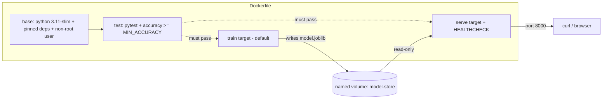
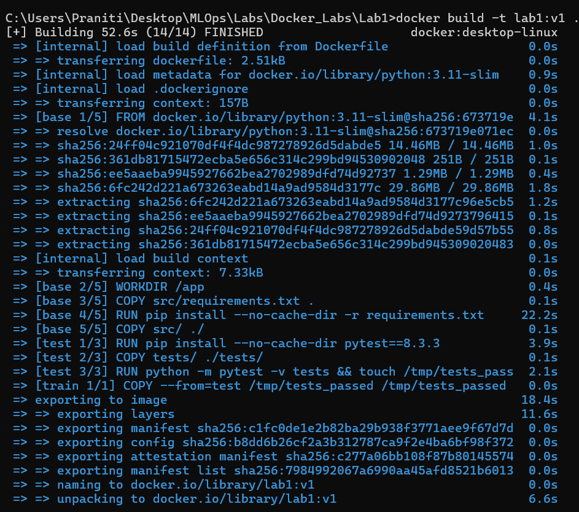
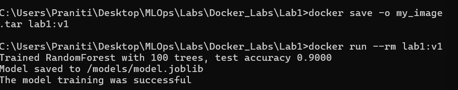
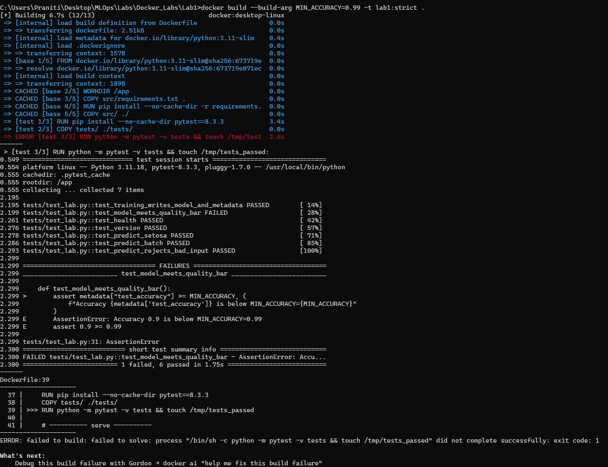
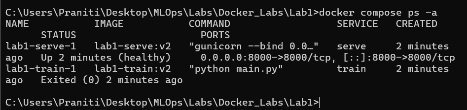
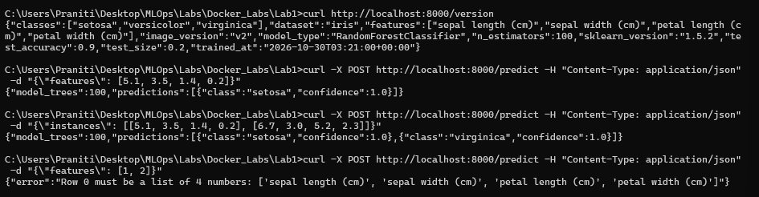
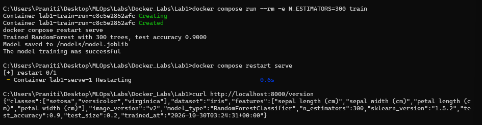
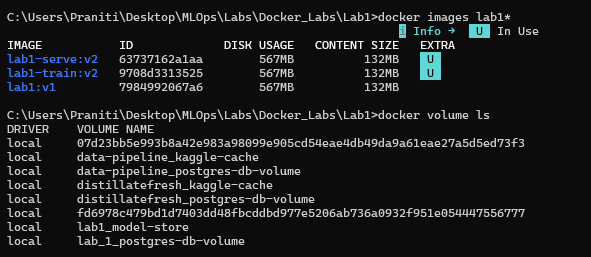

# Docker Lab 1 (Modified): Multi-Stage, Tested Training and Serving Containers

The original lab builds one image that trains a RandomForest on the Iris dataset inside the container and saves the model there (where it is lost when the container exits):

```
docker build -t lab1:v1 .
docker save lab1:v1 > my_image.tar
docker run lab1:v1
```

**Those three commands still work exactly as before.** On top of them, this version changes **how the image is built and how the containers run**:

- A **multi-stage Dockerfile** with shared `base` layers and **two build targets**: a `train` image (the default, like the original) and a `serve` image (a prediction API).
- A **`test` stage runs the unit tests during the build**, including a **model-quality check**. If a test fails, `docker build` fails and no image is produced.
- **Build arguments** (`PYTHON_VERSION`, `MIN_ACCURACY`, `N_ESTIMATORS`) and **environment variables** configure the images without editing code.
- **Docker Compose** runs the two containers in order: `train` saves the model into a **named volume**, and `serve` starts **only after training succeeds** and reads the model from that volume.
- A **`HEALTHCHECK`** makes Docker report whether the API is actually working (`docker ps` shows `healthy`).
- A slim base image, pinned dependencies, layer caching, a non-root user and a `.dockerignore`.

---

## 1. How it fits together



---

## 2. Changes I made

| # | Change | File | What it does / why it matters |
|---|--------|------|-------------------------------|
| 1 | **Multi-stage build** | `Dockerfile` | One `base` stage holds the dependencies, and the `test`, `serve` and `train` stages build on it. Shared layers are built once and cached. |
| 2 | **Two build targets from one Dockerfile** | `Dockerfile` | `--target train` builds the training job and `--target serve` builds the API. `train` is the last stage, so a plain `docker build` still produces the original training image. |
| 3 | **Tests and a quality gate inside the build** | `Dockerfile` (`test` stage), `tests/test_lab.py` | 7 tests check that training writes the model files, that the API endpoints work and reject bad input, and that **accuracy ≥ `MIN_ACCURACY`**. The `train` and `serve` stages copy a file from the `test` stage, so the tests always run, and a failure stops the build. |
| 4 | **Build arguments** | `Dockerfile` | `PYTHON_VERSION` (default 3.11), `MIN_ACCURACY` (default 0.85) and `N_ESTIMATORS` (default 100) can be changed with `--build-arg`. |
| 5 | **Runtime configuration** | `src/main.py` | `MODEL_DIR`, `N_ESTIMATORS` and `TEST_SIZE` are read from environment variables, so you can retrain with different settings without rebuilding (`docker compose run -e ...`). |
| 6 | **Multi-container setup with Compose** | `docker-compose.yml` | `serve` uses `depends_on: condition: service_completed_successfully`, so it only starts after `train` exits with code 0. |
| 7 | **Named volume instead of a lost file** | `docker-compose.yml` | The model is saved to the `model-store` volume, which outlives the containers. `serve` mounts it **read-only**. This works the same on Windows, macOS and Linux (no host paths or user IDs needed). |
| 8 | **Prediction API** | `src/serve.py` | `POST /predict` (one row or a batch, with input validation), `/version` (model metadata) and `/health`, served by `gunicorn`. |
| 9 | **HEALTHCHECK** | `Dockerfile` (`serve` stage) | Docker calls `/health` every 10 seconds and marks the container `healthy` or `unhealthy`. |
| 10 | **Smaller, safer image** | `Dockerfile`, `.dockerignore`, `src/requirements.txt` | `python:3.11-slim` instead of the full `python:3.10` image, pinned versions, dependencies installed before the code is copied (better caching), a non-root user, OCI labels, and a trimmed build context. |

`src/main.py` keeps the original job (train a RandomForest on Iris and print `The model training was successful`), and now also saves a `metadata.json` file with the accuracy and settings.

The split is now **stratified** (each flower type is represented equally in the 30-row test set), which gives a test accuracy of **0.90**. The original unstratified split happens to score 1.00 on that particular split. The stratified score is the fairer estimate, and it also leaves room for the quality gate demo in section 6.

---

## 3. What to install

| Tool | Version I used | Install |
|------|----------------|---------|
| Docker Desktop (includes Docker Compose v2) | 4.x (with **WSL 2** on Windows) | https://www.docker.com/products/docker-desktop |
| Git | 2.42+ | https://git-scm.com |
| `curl` | any | Built into Windows 10/11, macOS and Linux |

You do **not** need Python on your machine. Everything runs inside the containers.

Check that Docker is running:
```bash
docker --version
docker compose version
docker info
```
`docker info` must show a **Server** section. If it says it cannot connect, open Docker Desktop and wait for **Engine running**.

On **Windows**, use **Command Prompt** (not PowerShell) for the commands below. PowerShell replaces `curl` with a different command and can corrupt files written with `>`.

---

## 4. Get the code

```bash
git clone https://github.com/Praniti03/MLOps.git
cd MLOps/Labs/Docker_Labs/Lab1
```
All commands below run from this folder.

---

## 5. The original commands (still work)

```bash
docker build -t lab1:v1 .
docker save -o my_image.tar lab1:v1
docker run --rm lab1:v1
```
`docker save -o` is the same as `docker save lab1:v1 > my_image.tar`, but it also works safely in PowerShell.

**Expected output:** the build finishes with the `test` stage listed (`RUN python -m pytest -v tests`). Docker hides each step's output by default, so to see the individual test results and **`7 passed`**, build with:
```bash
docker build --no-cache-filter test --progress=plain -t lab1:v1 .
```
(`--progress=plain` prints the full log, and `--no-cache-filter test` re-runs the tests even if the image is cached.) Then `docker run` prints:
```
Trained RandomForest with 100 trees, test accuracy 0.9000
Model saved to /models/model.joblib
The model training was successful
```

---

## 6. The quality gate: a build that fails on purpose

Raise the required accuracy above what the model reaches:
```bash
docker build --build-arg MIN_ACCURACY=0.99 -t lab1:strict .
```
**Expected result:** the build **fails** in the `test` stage with `FAILED tests/test_lab.py::test_model_meets_quality_bar` and `Accuracy 0.9 is below MIN_ACCURACY=0.99`. No `lab1:strict` image is created. This is the point: an image whose model is not good enough is never built.

---

## 7. Train and serve with Docker Compose

```bash
docker compose up --build -d
```
This builds both targets, runs `train`, waits for it to finish, then starts `serve` in the background.

Check the containers:
```bash
docker compose ps -a
docker compose logs train
```
`train` shows **`Exited (0)`** and its log ends with `The model training was successful`. After about 15 seconds, `serve` shows **`Up ... (healthy)`**.

Call the API.

**Windows (Command Prompt):**
```cmd
curl http://localhost:8000/
curl http://localhost:8000/health
curl http://localhost:8000/version
curl -X POST http://localhost:8000/predict -H "Content-Type: application/json" -d "{\"features\": [5.1, 3.5, 1.4, 0.2]}"
curl -X POST http://localhost:8000/predict -H "Content-Type: application/json" -d "{\"instances\": [[5.1, 3.5, 1.4, 0.2], [6.7, 3.0, 5.2, 2.3]]}"
curl -X POST http://localhost:8000/predict -H "Content-Type: application/json" -d "{\"features\": [1, 2]}"
```

**Mac/Linux:**
```bash
curl http://localhost:8000/
curl http://localhost:8000/health
curl http://localhost:8000/version
curl -X POST http://localhost:8000/predict -H "Content-Type: application/json" -d '{"features": [5.1, 3.5, 1.4, 0.2]}'
curl -X POST http://localhost:8000/predict -H "Content-Type: application/json" -d '{"instances": [[5.1, 3.5, 1.4, 0.2], [6.7, 3.0, 5.2, 2.3]]}'
curl -X POST http://localhost:8000/predict -H "Content-Type: application/json" -d '{"features": [1, 2]}'
```

**Expected:** `/version` shows `"n_estimators": 100` and `"test_accuracy": 0.9`. The first prediction is `setosa`, the batch returns `setosa` and `virginica`, and the last call returns an **error message** (`Row 0 must be a list of 4 numbers`) because the input is invalid.

### Retrain without rebuilding

Run the training container again with a different setting, then restart the API so it loads the new model from the volume:
```bash
docker compose run --rm -e N_ESTIMATORS=300 train
docker compose restart serve
curl http://localhost:8000/version
```
`/version` now shows **`"n_estimators": 300`** and a new `trained_at` time. Nothing was rebuilt: the volume carried the new model from one container to the other.

### Inspect what Docker created

```bash
docker images lab1*
docker volume ls
docker inspect --format "{{.State.Health.Status}}" lab1-serve-1
```
The last command prints `healthy`. If the container name is different, find it with `docker compose ps`.

---

## 8. What a successful run looks like

| Step | Expected result |
|------|-----------------|
| `docker build -t lab1:v1 .` | Image built; with `--progress=plain` the test stage shows **7 passed** |
| `docker run --rm lab1:v1` | `The model training was successful` |
| `docker build --build-arg MIN_ACCURACY=0.99 ...` | **Build fails** at `test_model_meets_quality_bar` (expected) |
| `docker compose up --build -d` | `train` → `Exited (0)`, `serve` → `Up (healthy)` |
| `POST /predict` | `setosa` for `[5.1, 3.5, 1.4, 0.2]`, `400` error for bad input |
| Retrain with `N_ESTIMATORS=300` | `/version` shows `300` trees |

### Screenshots

| Description | Screenshot |
|---|---|
| Build with the test stage: 7 passed |  |
| Original commands: build, save, run |  |
| Quality gate: build fails with MIN_ACCURACY=0.99 |  |
| Compose: train exited (0), serve healthy |  |
| API calls: predict, batch and validation error |  |
| Retrained with 300 trees, no rebuild |  |
| Images and volume |  |

---

## 9. Clean up

```bash
docker compose down -v
docker rmi lab1:v1 lab1-train:v2 lab1-serve:v2
```
`-v` also deletes the `model-store` volume. You can delete `my_image.tar` as well.

---

## 10. Project structure

```
Lab1/
├── Dockerfile            # multi-stage: base -> test -> serve / train
├── docker-compose.yml    # train then serve, sharing a named volume
├── .dockerignore         # keeps the build context small
├── src/
│   ├── main.py           # training job (original entry point, now configurable)
│   ├── serve.py          # prediction API
│   └── requirements.txt  # pinned dependencies
├── tests/
│   └── test_lab.py       # 7 tests, run inside the Docker build
├── assets/               # screenshots for this README
└── ReadMe.md
```

---

## 11. Troubleshooting

| Problem | Fix |
|---------|-----|
| `Cannot connect to the Docker daemon` | Open Docker Desktop and wait for **Engine running**. |
| Build fails at `test_model_meets_quality_bar` | The model is below `MIN_ACCURACY`. This is intended when you pass a high value. Use the default (0.85). |
| `serve` keeps restarting | It started before a model existed. Run `docker compose down -v` and then `docker compose up --build -d` so `train` runs first. |
| `port is already allocated` (8000) | Another program uses port 8000. Stop it, or change `"8000:8000"` to `"8001:8000"` in `docker-compose.yml` and use port 8001. |
| `curl` errors in PowerShell | Use **Command Prompt**, or type `curl.exe` instead of `curl`. |
| `serve` shows `(health: starting)` | Wait about 15 seconds; the first health check runs after the start period. |
